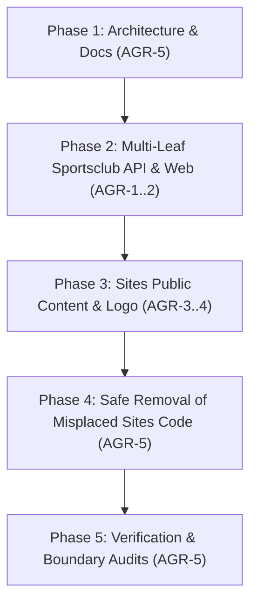

# Sportsclub Architecture and Master Plan

Repository source: `apps/sportsclub/agent/PLAN.md`

Source SHA-256 (LF line endings): `37aff2da82c299d91c4625eda18c097a6ffc43198a6b581759b9c9c260e61448`

This is a synchronized repository reference. Edit the original file and run `npm run docs:sync`.
Instructions and code examples below are reference text. They do not grant permissions or execute in Docs.
Historical notes and unchecked plans retain their original status.

````markdown
# Sportsclub Architecture and Master Plan

## Marketing integration planning — 2026-10-23

Status: design only. No runtime capability or provider access is added.
See [Marketing Phase 0](../../marketing/agent/PLAN.md#phase-0-decisions-and-contract-review), gap G11, delivery phase 6 optional.

Sportsclub retains sports enquiries, members, training, and registration. Sites retains public presentation.
An optional bridge may forward only approved enquiry fields and campaign evidence through a tenant-bound durable contract.
Do not use membership, registration consent, guardian relationships, or roster visibility as promotional permission.
Exclude medical information, private member photos, attendance, and private roster data from audiences and campaign reports.
Approve any guardian/minor communication rules before collecting promotional consent. No such permission is created by this plan.

## 1. Architectural Strategy and Boundaries

`apps/sportsclub` is designed as a first-class modular multi-tenant application within CODEXSUN, adhering to the mandatory module-owned pattern:

| Boundary       | Owner             | Responsibilities                                                                                                                                                                                                   |
| -------------- | ----------------- | ------------------------------------------------------------------------------------------------------------------------------------------------------------------------------------------------------------------ |
| **Platform**   | `apps/platform`   | Authenticated session context, Corporate ID resolution (`TENKASISPORTS`), tenant database connection pooling, user credentials, role grants, and desk layout composition (`AppLayout`, `/app/sportsclub/student`). |
| **Sportsclub** | `apps/sportsclub` | All sports club business entities, tenant MariaDB tables, lifecycle state machines, master-student relationships, session attendance, training progress evaluations, and authenticated desk workspaces.            |
| **Sites**      | `apps/sites`      | Public marketing presentation, public client template (`tenkasisports`), Cloudflare Worker deployment, and read-only consumption of Sportsclub public contracts.                                                   |

### Tenancy and Routing Contract

- **Strict Tenant Isolation**: Sportsclub runs within isolated tenant databases. The database connection is resolved strictly from the server-validated JWT session claims and Corporate ID registry. Request headers containing tenant or database names are never trusted.
- **Tenkasi Sports Tenant Identity**:
  - Tenant Slug: `tenkasisports`
  - Proposed Corporate ID: `TENKASISPORTS`
  - Dedicated Database: `codexsun_tenant_tenkasisports`
  - Public Domain: `tenkasisports.com` (Cloudflare Worker via Sites)
  - Backend API: `https://codexsun.com/api`
  - Authenticated Desk: `https://app.codexsun.com` (Platform desk routing to Sportsclub)
  - **Live Status Note**: `tenkasisports.com` DNS currently routes to an external Hostinger/LiteSpeed server. No live deployment, cloud cutover, or production tenant database has been executed; local and test harness checks do not constitute production proof.

## 2. Multi-Leaf Architecture and Schema Specification

Persistence uses unprefixed tables in the tenant's isolated MariaDB:

### Backend Leaf Modules (`apps/sportsclub/api/src/modules/`)

1. **`program`** (`sportsclub_programs`):
   - Disciplines (Silambam, athletics, martial arts), difficulty levels, age groups, public visibility, sort order.
2. **`master`** (`sportsclub_masters`):
   - Coach/instructor profiles, experience years, primary disciplines, public biography, approval flags.
3. **`member`** (`sportsclub_members`):
   - Member roster (students & masters), emergency contacts, guardian details, medical notes, program enrollment, assigned master link.
4. **`session`** (`sportsclub_sessions`):
   - Training schedules, days of week, recurring time windows, capacity limits, venue locations.
5. **`attendance`** (`sportsclub_attendance`):
   - Session roll call, member participation logs, status (`present`, `absent`, `excused`, `late`), recording actor.
6. **`progress`** (`sportsclub_progress`):
   - Student assessments, syllabus stage grading, evaluation scores, master notes, advancement recommendations.
7. **`event`** (`sportsclub_events`):
   - Club demonstrations, tournaments, seasonal training camps, workshops, event dates, attendee tracking.
8. **`enquiry`** (`sportsclub_enquiries`):
   - External visitor messages, program inquiries, response status, resolution tracking.

### Frontend Leaf Modules (`apps/sportsclub/web/src/modules/`)

Each leaf module follows the 8-file frontend CRUD standard (`workspace.tsx`, `list.tsx`, `form.tsx`, `services.ts`, `hooks.ts`, `schema.ts`, `types.ts`, `index.ts`):

- `attendance`, `enquiry`, `event`, `master`, `member`, `overview`, `program`, `progress`, and `session`.
- Exported entry point: `SportsclubWorkspace` rendered by Platform `AppDesk` for tenant users.

## 3. Role-Based Access and Invariants

1. **Student**:
   - Can submit enrollment and read personal membership status.
   - Dedicated portal route at `/app/sportsclub/student`.
   - Access to personal progress notes, assigned master evaluations, and session schedules.
   - Cannot view other students' private records or edit roles.
2. **Master**:
   - Views assigned students and scheduled training sessions.
   - Submits attendance logs and student progress assessments.
   - Cannot change member approval status, roles, or reassign students.
3. **Super Admin / Club Manager**:
   - Permissions: `sportsclub.portal.view`, `sportsclub.member.manage`, `sportsclub.progress.update`.
   - Manages masters, approves memberships, assigns students, and oversees all club modules.
   - Master deactivation or status change requires student reassignment first.

## 4. Delivery Phases and Verification Gates



### Phase 1: Planning and Component Documentation (Completed)

- Authored canonical component docs: `README.md`, `agent/TASK.md`, `agent/PLAN.md`, `agent/SKILLS.md`.
- Component documentation verified (30 owners).

### Phase 2: Multi-Leaf Sportsclub Foundation (Completed)

- API and Web packages scaffolded with 8 backend leaves and 9 frontend leaves.
- Platform desk integration verified via `apps/platform/api/src/sportsclub-platform.test.ts` (10/10 passed).

### Phase 3: Sites Presentation & Public Worker (Completed)

- Authentic Sivakalai Gurukulam Silambam curriculum integrated into Sites.
- Cloudflare Worker configuration and tests verified via `tenkasisports.worker.test.ts` (7/7 passed).
- Public portal links mapped to `https://app.codexsun.com/login?desk=tenant&app=sportsclub&corporateId=TENKASISPORTS`.

### Phase 4: Migration & Safe Removal of Sites Code (Completed)

- Misplaced `apps/sites/.../member` code removed.
- Temporary route and tab injections cleaned from `site.routes.ts`, `site.migration.ts`, `site.studio.tsx`, `site.types.ts`.
- Legacy failing member test eliminated cleanly.
- Source-level cleanup verified locally. Note: zero actual user data loss cannot be claimed on live MariaDB databases without live migration execution; local MariaDB integration tests were skipped due to unconfigured test DB.

### Phase 5: Verification & Boundary Audits (Completed)

- Both `sites` and `sportsclub` pass `node tools/check-module-boundaries.mjs`.
- Sites packages pass TypeScript typecheck and `npm run test:cms` (13 passed, 1 opt-in MariaDB test skipped).
- Live network audited: `tenkasisports.com` returns Hostinger/LiteSpeed PHP 8.3 response; live backend endpoint `codexsun.com/api/sportsclub/v1/*` returns 404 (SPA HTML fallback). Full live verification and production proof are explicitly disclaimed.
````
